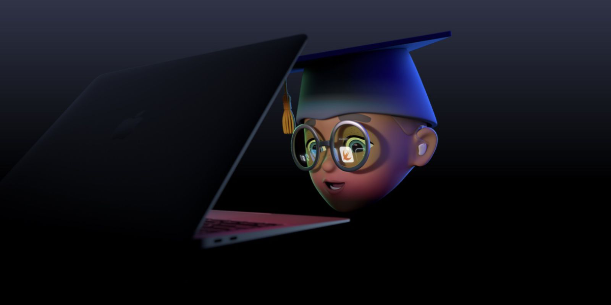

# WWDC 2021 - Swift Student Challenge

List of student submissions for the WWDC 2021 - Swift Student Challenge. The list is in alphabetical order.

### How to add your submission?
1. **[Click here to open the form](https://github.com/wwdc/2021/issues/new?template=submit.yml)** and fill it in.
2. Send it. A bot checks your entry within a minute and tells you if anything needs fixing. You can edit the form after sending.
3. When it is approved your entry appears on this list.

#### How to update or remove your submission?
Use the **[update form](https://github.com/wwdc/2021/issues/new?template=update.yml)**. Only the person who sent the entry can change it.

### Submissions

| Participant | Links  | Status            |
|:--|:--|:--|
| \[Derek Hsieh\] | [GitHub](https://github.com/DerekHsiehDev/WWDC-2021.git) AVFoundation, NaturalLanguage, SwiftUI, CoreML +2 |  |
| [A. Alkan Caner](https://github.com/AlkanCaner) | [GitHub](https://github.com/AlkanCaner/StylizedArt) · [Video](https://www.youtube.com/watch?v=V2-lZlgsD1k&t=4s) SwiftUI, CoreML |  |
| [Adam Zhao](https://github.com/ZXXZ00) | [Video](https://youtu.be/_wrRRgDcfdA) Accelerate, PencilKit, UIKit |  |
| [Alan Yan](https://github.com/yan-alan) | [GitHub](https://github.com/yan-alan/Dance-Party) Vision, AVFoundation, SwiftUI, UIKit |  |
| [Alperen Örence](https://github.com/alperenorence) | [GitHub](https://github.com/alperenorence/chatbots) SwiftUI, Combine |  |
| [Alvin Hsueh](https://www.instagram.com/qazqwe0922/) | [GitHub](https://github.com/HaXAlvin/WWDC21_Hello_World) SwiftUI, SpriteKit, ARKit, UIKit |  |
| [Anant Kanchan](https://github.com/anantcodes) | [GitHub](https://github.com/anantcodes/NaviOS) SwiftUI |  |
| [Anav Mehta](http://3dwaffles.blogspot.com) | [GitHub](https://github.com/anavmehta/ChessRealityPlaygroundBook) · [Video](https://youtu.be/tLK6NKbC-NQ) RealityKit, AVKit, RealityComposer |  |
| [Andrean Lay](https://github.com/andreanlay) | [GitHub](https://github.com/andreanlay/jebot-wwdc21) SwiftUI, AVFoundation |  |
| [Andrew Glen](https://github.com/nanothread) | [GitHub](https://github.com/nanothread/Functional-Programming-With-Physics) SpriteKit, SwiftUI |  |
| [Andrew Z](https://github.com/aheze/) | [GitHub](https://github.com/aheze/AccessibleReality) · [Video](https://www.youtube.com/watch?v=BH2HONBJiF0) SwiftUI, ARKit, Vision |  |
| [Arjun Dureja](https://github.com/arjun-dureja) | [GitHub](https://github.com/arjun-dureja/WWDC21-Swift-Student-Challenge) · [Video](https://www.youtube.com/watch?v=BNntCgua848) UIKit |  |
| [Atulya Weise](https://atulya.me) | [GitHub](https://github.com/atultw/physics-swift) SpriteKit, SwiftUI |  |
| [Baran Önen](https://github.com/baranonen) | [GitHub](https://github.com/baranonen/WWDC21-Barcodes) SwiftUI, SpriteKit |  |
| [Barbra Eliza](https://github.com/barbraeliza) | [GitHub](https://github.com/barbraeliza/WWDC2021) · [Video](https://www.youtube.com/watch?v=p1udeXu4F4U) SpriteKit, AVFoundation |  |
| [Batuhan Karababa](https://github.com/batuhankrbb) | [GitHub](https://github.com/batuhankrbb/AppleHeroes) · [Video](https://www.youtube.com/watch?v=w1ceszjuaco) SwiftUI |  |
| [Benjamin Hutter](https://github.com/benjaminhtr) | [GitHub](https://github.com/benjaminhtr/WWDC21) SwiftUI, SpriteKit, UIKit |  |
| [Benji Burgess](https://twitter.com/benj_io) | [GitHub](https://github.com/benjiburgess/wwdc21) SwiftUI |  |
| [Berkin Ceylan](https://github.com/berkinceylan) | [GitHub](https://github.com/berkinceylan/WWDC21) SwiftUI, AVFoundation |  |
| [Bryanza Novirahman](https://github.com/bryanzanr) | [GitHub](https://github.com/bryanzanr/skipper) · [Video](https://youtu.be/rUaxRIN6_CE) SwiftUI |  |
| [Can Balkaya](https://github.com/canbalkaya) | [GitHub](https://github.com/canbalkaya/Machine-Dreams-WWDC21) ARKit, SceneKit, CoreML, SwiftUI |  |
| [Choyi Jeong](https://github.com/iamcho2) | [GitHub](https://github.com/iamcho2/WWDC-2021) SwiftUI, SpriteKit |  |
| [Christian Privitelli](https://github.com/Priva28) | [GitHub](https://github.com/Priva28/Swift3D) SwiftUI, SceneKit, ARKit |  |
| [Corentin Medina](https://twitter.com/Elfyro) | [GitHub](https://github.com/CorentiOS/WWDC2021) · [Video](https://www.youtube.com/watch?v=IRqJCoCRcs4) SpriteKit, GameplayKit, AVFoundation |  |
| [Cristian Garske](https://www.instagram.com/oddghostly/) | [GitHub](https://github.com/CristianGarske/WWDC21) · [Video](https://youtu.be/26w5qdg78_s) SwiftUI |  |
| [Darshil Agrawal](https://twitter.com/agrawal_darshil) | [GitHub](https://github.com/darshilagrawal/WWDC2021-Submission-Accepted-) CrytpoKit, SwiftUI |  |
| [David Knothe](https://github.com/knothed) | [GitHub](https://github.com/knothed/Symmetries) Accelerate, CoreAnimation |  |
| [Davin Djayadi](https://github.com/davindj) | [GitHub](https://github.com/davindj/add-modulo) SpriteKit, AVFoundation |  |
| [Deniz Karakay](https://twitter.com/KarakayDeniz) | [GitHub](https://github.com/dkarakay/wwdc-2021-perfec0) SpriteKit, AVFoundation, SwiftUI, UIKit |  |
| [Dhanraj Chavan](https://twitter.com/codingpotter) | [GitHub](https://github.com/dhanrajdc7/CryptoCam) · [Video](https://youtu.be/gMEdtcLDdGU) UIKit, Vision, AVFoundation |  |
| [Djenifer R Pereira](https://github.com/djeni98) | [GitHub](https://github.com/djeni98/naipi-and-taroba) · [Video](https://www.youtube.com/watch?v=NP4XIpNLOc4) SpriteKit |  |
| [Don Chia](https://donchia.tech) | [GitHub](https://github.com/dhs17y2adonchia/WWDC2021) SwiftUI, UIKit, WKWebView |  |
| [Elaine Cruz](https://github.com/elainecruz) | [GitHub](https://github.com/elainecruz/WWDC21) UIKit, RealityKit |  |
| [Erick Almeida](https://github.com/erick2280) | [GitHub](https://github.com/erick2280/dines-donkey-playground) SwiftUI |  |
| [Federico Ciardi](https://github.com/fedeci) | [GitHub](https://github.com/fedeci/WWDC2021) SceneKit, SpriteKit, AVFoundation, Combine |  |
| [Filip Kania](https://github.com/filipkania) | [GitHub](https://github.com/filipkania/getout.) SceneKit, AVFoundation, AppKit |  |
| [Fred P](https://github.com/fredpi) | [GitHub](https://github.com/fredpi/WWDC2021) UIKit, CoreAnimation, CoreGraphics |  |
| [Frederico Lacis](https://github.com/fredlacis) | [GitHub](https://github.com/fredlacis/GeneticAlgorithms_WWDC21) · [Video](https://www.youtube.com/watch?v=-wLLsycY_cs) SwiftUI |  |
| [Furkan Hancı](https://github.com/Furkanus) | [GitHub](https://github.com/Furkanus/BioShine) SwiftUI |  |
| [Gabriel Muelas](https://github.com/MuelasU) | [GitHub](https://github.com/MuelasU/wwdc21-float-or-sink) · [Video](https://youtu.be/fin79NjjNHw) SwiftUI |  |
| [Garima Bothra](https://github.com/garima94921) | [GitHub](https://github.com/garima94921/DoubleSpending-WWDC21) CryptoKit, SwiftUI |  |
| [Garv Shah](https://github.com/garv-shah) | [GitHub](https://github.com/garv-shah/WWDC21-Galton-Board) SpriteKit, UIKit |  |
| [Gokul R Nair](https://github.com/gokulnair2001) | [GitHub](https://github.com/gokulnair2001/WWDC_SSC_2021) UIKit |  |
| [Gustavo Tatarem](https://github.com/gustatarem) | [GitHub](https://github.com/gustatarem/choose-your-car) · [Video](https://youtu.be/QINtUIOSEDc) SpriteKit, AVFoundation |  |
| [Haobo Xu](https://haoboxuxu.github.io) | [GitHub](https://github.com/haoboxuxu/WWDC2021-TheHackOfRayTracing) · [Video](https://youtu.be/LqT7yQC8kk4) MetalKit, Ray-Tracing algorithms |  |
| [Haotian Zheng](https://fincher.im/) | [GitHub](https://github.com/JustinFincher/WWDC2021ScholarshipProject) · [Video](https://www.youtube.com/watch?v=AT6XDYx_aRg) ARKit, SceneKit, MetalKit, SwiftUI |  |
| [Henri Bredt](https://github.com/henribredt) | [GitHub](https://github.com/henribredt/UserExperience-WWDC21) SwiftUI |  |
| [Hugo Lispector](https://hugolispector.com) | [Video](https://youtu.be/Vm2tvazcDwU) SpriteKit |  |
| [Ibrahim Berat Kaya](https://github.com/iberatkaya) | [GitHub](https://github.com/iberatkaya/wwdc21) · [Video](https://www.youtube.com/watch?v=AhJjLU_ENXs) SwiftUI |  |
| [Íris Soares](https://github.com/irixs) | [GitHub](https://github.com/irixs/irix-playground) · [Video](https://www.youtube.com/watch?v=rDYsMPE_YUs) SwiftUI |  |
| [Ishan Chhabra](https://github.com/ishan-chhabra) | [GitHub](https://github.com/ishan-chhabra/spacewalk) · [Video](https://www.youtube.com/watch?v=lOLcMdaWx5s) AVFoundation, SpriteKit |  |
| [Izabella Melo](https://github.com/izmcm) | [GitHub](https://github.com/izmcm/WhatIsSQLi) SwiftUI |  |
| [Jakub Florek](https://github.com/MAJKFL) | [GitHub](https://github.com/MAJKFL/Wonderful_Icons-WWDC21) · [Video](https://youtu.be/6VkkqBUv13s) SwiftUI, UIKit, Combine, AVFoundation |  |
| [Jan Luca Siewert](https://jl-siewert.de/about) | [GitHub](https://github.com/jlsiewert/SwiftAR) · [Video](https://youtu.be/3GeFRthFBs8) ARKit, SceneKit, SwiftUI |  |
| [Javier Gallo Roca](https://twitter.com/Happygallo) | [GitHub](https://github.com/Happygallo/LangtonsAnt.git) · [Video](https://youtu.be/gCRG00CTZCo) SpriteKit, SwiftUI |  |
| [Jia Chen](https://github.com/jiachenyee) | [GitHub](https://github.com/jiachenyee/wwdc21explorer) SceneKit, UIKit, SwiftUI, NaturalLanguage |  |
| [Jimmy Tan](https://www.linkedin.com/chatin/wnc/in/jianhui-jimmy-tan-6b2595175) | [GitHub](https://github.com/JimmyTan823/wwdc) · [Video](https://www.youtube.com/watch?v=hwe_fkz52fs) SwiftUI, AVFoundation |  |
| [João Carlos Magalhães](https://www.youtube.com/channel/UCDNFUQY2XT44NXXZj7-oG-g) | [GitHub](https://github.com/joaocarlos-mag/WWDC-2021-Scholarship-Submission) UIKit, SpriteKit, SceneKit, Accelerate |  |
| [João Gabriel](https://twitter.com/joogps) | [GitHub](https://github.com/joogps/WWDC-2021) SwiftUI, AVFoundation |  |
| [Joe Naveau](https://twitter.com/joenaveau) | [Video](https://www.youtube.com/watch?v=3pef6mkJGJc&list=PLZw7eGQJuMjlFtuO2dc1DazkhwaOIgfSo&index=36&t=1s) SpriteKit, AVFoundation |  |
| [Jose Adolfo Talactac](https://twitter.com/devjoseadolfo) | [GitHub](https://github.com/devjoseadolfo/CircuitPlay) · [Video](https://youtu.be/pm3mlDZJSes) SwiftUI, Accelerate, RealityKit, ARKit |  |
| [Julian Benedikt Heuschen](https://twitter.com/HeuschenJ) | [GitHub](https://github.com/jbheuschen/Cryptography) SwiftUI, Security, CryptoKit, CommonCrypto |  |
| [Julian Schiavo](https://twitter.com/_julianschiavo) | [GitHub](https://github.com/julianschiavo/wwdc/) AVFoundation, CoreML, SwiftUI, Vision |  |
| [Juliano Vaz](https://www.github.com/julianoctvaz/) | [GitHub](https://www.github.com/julianoctvaz/jardimHarmonico) UIKit, AVFoundation |  |
| [Jun (June) Murakami](https://github.com/juneforceone) | [GitHub](https://github.com/juneforceone/iRecognizer) · [Video](https://youtu.be/9_jidssBG9c) SwiftUI, CoreML, ARKit |  |
| [Junaid Abdurahman](https://twitter.com/junaidxabd) | [Video](https://youtu.be/GUCHvjWpotY) UIKit, CoreML, QuartzCore |  |
| [Kee Meng](https://github.com/KeeMeng) | [GitHub](https://github.com/KeeMeng/swift-kaleidoscope) UIKit |  |
| [Kenneth Chew](https://github.com/kthchew) | [GitHub](https://github.com/kthchew/wwdc21-combustion) SpriteKit, SwiftUI |  |
| [Krish Jain](https://github.com/Krish-sysadmin) | [GitHub](https://github.com/Krish-sysadmin/WWDC2021) UIKit, SpriteKit |  |
| [Kunal Bagaria](https://twitter.com/kb24x7) | [GitHub](https://github.com/kb24x7/wwdc-2021) AVFoundation, SwiftUI |  |
| [Lambo Zhuang](https://github.com/Lambozhuang) | [GitHub](https://github.com/Lambozhuang/Playground_CameraSimulator) UIKit |  |
| [Lee Jaeho](https://github.com/jaeho0718) | [GitHub](https://github.com/jaeho0718/WWDC2021_Student_Challenge) SpriteKit, UIKit, PlaygroundBook |  |
| [Leon Zhao](https://github.com/Confucius52) | [GitHub](https://github.com/Confucius52/WWDC2021_submission) UIKit |  |
| [Liam Rosenfeld](https://twitter.com/liamrosenfeld) | [GitHub](https://github.com/liamrosenfeld/SeamCarving) Metal, CoreGraphics, Accelerate, SwiftUI |  |
| [Lucas Wang](https://github.com/Lucas-ZX-W) | [GitHub](https://github.com/Lucas-ZX-W/apple_silicon_history) UIKit, AVFoundation, AVSpeechSynthesizer |  |
| [Luis Genesius](https://github.com/lgenesius) | [GitHub](https://github.com/lgenesius/unity-in-diversity-wwdc21) UIKit, AVFoundation, AVSpeechSynthesizer |  |
| [M. Bertan Tarakçıoğlu](https://medium.com/@bertan.tarakcioglu) | [GitHub](https://github.com/BertanT/The-ADHD-Exploration-WWDC21) SwiftUI, Combine, PhotosUI |  |
| [Maiara Martins](https://github.com/MaiaraM) | [GitHub](https://github.com/MaiaraM/WWDC21-Ballet) · [Video](https://youtu.be/tkAKTPRCCf8) SpriteKit, AVSpeechUtterance, AVSpeechSynthesizer, AVPlayer +1 |  |
| [Makwan Barzan](https://twitter.com/makwanbk) | [GitHub](https://github.com/m1bki0n/Kazhe) SwiftUI, AVFoundation |  |
| [Maria Fernanda Azolin](https://github.com/azolinmf) | [GitHub](https://github.com/azolinmf/wwdc21-mixedFeelings) · [Video](https://www.youtube.com/watch?v=KZIUHNLthZg) SpriteKit, UIKit |  |
| [Mateus Levi Fernandes](https://github.com/mateuslevisf) | [GitHub](https://github.com/mateuslevisf/wwdc21-compgraphics101) SpriteKit |  |
| [Matheus Andrade](https://github.com/matheusvtna) | [GitHub](https://github.com/matheusvtna/Mixed-Juice) SwiftUI, AVKit |  |
| [Matheus Gois](https://github.com/MaatheusGois) | [Video](https://youtu.be/_-NE_9EmK7c) UIKit, SpriteKit |  |
| [Matheus Homrich](https://github.com/matheushomrich) | [GitHub](https://github.com/matheushomrich/GoodMorningSwiftyWWDC2021) SwiftUI |  |
| [Matheus S. Moreira](https://github.com/matheussmoreira) | [GitHub](https://github.com/matheussmoreira/Squance) SwiftUI |  |
| [Maxime Madrau](https://github.com/Maxmad68) | [GitHub](https://github.com/Maxmad68/Lightning-Simulator) SpriteKit |  |
| [Mehdi Hussain](https://github.com/mehdihdev) | [GitHub](https://github.com/mehdihdev/WWDC2021) · [Video](https://youtu.be/T32k8JW4J0g) UIKit, SpriteKit, SceneKit |  |
| [Mrinal Tyagi](https://github.com/MrinalTyagi) | [GitHub](https://github.com/MrinalTyagi/WWDC-2021-Swift-Challenge-Submission) UIKit |  |
| [Murilo Gonçalves](https://github.com/murilo-goncalves) | [GitHub](https://github.com/murilo-goncalves/WWDC2021-VSSS) SpriteKit |  |
| [Nathaniel Fargo](https://paradox42.tech) | [GitHub](https://github.com/theParadox42/Relativity) SpriteKit, SceneKit |  |
| [Nguyen (Zoey) Vu](https://github.com/ThanhNguyenVu) | [GitHub](https://github.com/ThanhNguyenVu/Meal-WWDC21) SwiftUI, AVFoundation |  |
| [Niall Kehoe](https://twitter.com/Niall_Kehoe) | [GitHub](https://github.com/niallkehoe/GreatMinds) · [Video](https://www.youtube.com/watch?v=_m4rY34BQbM) SwiftUI, ARKit, RealityKit, SpriteKit |  |
| [Niklas Bülow](https://twitter.com/NiklasBuelow) | [GitHub](https://github.com/insightmind/WWDC21SwiftStudentChallenge) SpriteKit, UIKit, AVFoundation |  |
| [Omar Abusharar](http://github.com/omartheturtle) | [Video](https://youtu.be/fo5AtVe_PJk) SwiftUI |  |
| [Oscar Fridh](https://www.linkedin.com/in/oscar-fridh-03279b125/) | [GitHub](https://github.com/OscarFridh/SwiftSearch) SpriteKit |  |
| [Oscar Gorog](https://github.com/OscarGorog) | [GitHub](https://github.com/OscarGorog/WWDC21-Playground) SwiftUI, Combine, RealityKit, AVFoundation |  |
| Ozan Mirza | [GitHub](https://github.com/ozanm/WWDC-2021-Neural-Networks) UIKit, CoreGraphics, Accelerate |  |
| [Peter Yaacoub](https://github.com/Yaacoub) | [GitHub](https://github.com/Yaacoub/Swift-Student-Challenge/tree/master/WWDC%202021) · [Video](https://youtu.be/pjSYAEYOPhk) AVFoundation, CoreMotion, SpriteKit, UIKit |  |
| [Prajwal Kulkarni](https://twitter.com/prajwalinbizz) | [GitHub](https://github.com/prajwalkulkarni/WWDC21) · [Video](https://youtu.be/GgATVEkmmKI) AVFoundation, SpriteKit, SwiftUI, UIKit |  |
| [Riccardo Persello](https://github.com/persello) | [GitHub](https://github.com/persello/ssc21) Accelerate |  |
| [Richard Qi Zhi](https://twitter.com/riccqi) | [GitHub](https://github.com/riccqi/Encryption-Book) CryptoKit, SpriteKit, SwiftUI |  |
| [Riku Arakawa](https://github.com/rikulh) | [GitHub](https://github.com/rikulh/Ohajiki) SwiftUI, SpriteKit |  |
| [Rodrigo Matos](https://github.com/Rudigus) | [GitHub](https://github.com/Rudigus/shaderland) SceneKit, SpriteKit, UIKit |  |
| [Roy Rao](https://github.com/RoyRao2333) | [GitHub](https://github.com/RoyRao2333/WWDC21-Apple-Scholarship) Cocoa, SwiftUI, Combine, AVKit |  |
| [Ryan Du](https://github.com/ryendu) | [GitHub](https://github.com/ryendu/exploring-ml) · [Video](https://youtu.be/K9yRi89Ub5U) SwiftUI, SpriteKit |  |
| [Ryan Rudes](https://github.com/Ryan-Rudes) | [GitHub](https://github.com/Ryan-Rudes/wwdc21) · [Video](https://www.youtube.com/watch?v=sLm7Xin9u0g) SwiftUI, AVFoundation |  |
| [Sabesh Bharathi](https://github.com/programVeins) | [GitHub](https://github.com/programVeins/rubysdilemma) · [Video](https://www.youtube.com/watch?v=6KlwMRYOupk) SwiftUI, AVFoundation, RealityKit, ARKit |  |
| [Sai Ranga Reddy](https://github.com/irangareddy) | [GitHub](https://github.com/irangareddy/Carbon-Footprint) · [Video](https://youtu.be/4uh_Aet8dMM) SwiftUI, AVKit, SceneKit |  |
| [Sascha Salles](https://github.com/saschasalles) | [GitHub](https://github.com/saschasalles/WWDC2021) ARKit, SceneKit, AVFoundation, SwiftUI |  |
| [Seunghun Yang](https://github.com/Yabby1997) | [GitHub](https://github.com/Yabby1997/WWDC21-Swift-Student-Challenge) · [Video](https://youtu.be/HVTCB2lDpjg) SpriteKit, AVFoundation |  |
| [Shaun Ku](https://github.com/Grotion) | [GitHub](https://github.com/Grotion/2021WWDC_Swift-Student-Challenge_Time-Flies) · [Video](https://youtu.be/k0bBiF7P3lc) SwiftUI, AVFoundation |  |
| [Shengjiu Shi](https://github.com/John-ssj) | [GitHub](https://github.com/John-ssj/WWDC2021) UIKit, SpriteKit |  |
| [Shengyuan Lu](https://www.linkedin.com/in/shengyuan-lu) | [Video](https://youtu.be/dY1R0TIHwjY) SwiftUI, ARKit, SceneKit, CoreMotion |  |
| [Stephen Fang](https://github.com/iamStephenFang) | [GitHub](https://github.com/iamStephenFang/KnowledgeGraph) SwiftUI, AVKit |  |
| [Stvya Sharma](http://stvya.com) | [GitHub](https://github.com/StvyaSharma/Mini_Games) UIKit, SpriteKit, AVFoundation, SwiftUI |  |
| [Subhronil Saha](https://github.com/subhronilsaha) | [GitHub](https://github.com/subhronilsaha/wwdc-21-submission) · [Video](https://www.youtube.com/watch?v=uFCORfnsnzw) SwiftUI, AVKit |  |
| [Swapnanil Dhol](https://github.com/SwapnanilDhol) | [GitHub](https://github.com/SwapnanilDhol/Inclusivity) · [Video](https://www.youtube.com/watch?v=ELeCD3yY7uU) Vision, SwiftUI, AVKit |  |
| [Sylvain Guillier](https://github.com/ElChoquito) | [Video](https://www.youtube.com/watch?v=MqWFkvcpAMk) Vision, SwiftUI, AVFoundation |  |
| [Tamerlan Satualdypov](https://github.com/onl1ner) | [GitHub](https://github.com/onl1ner/Hands) UIKit, AVFoundation, Vision |  |
| [Tejas Mehta](https://github.com/tmthecoder) | [GitHub](https://github.com/tmthecoder/MultiCalcPlayground) Vision, PencilKit, CoreGraphics, UIKit |  |
| [Theo Caldas](https://github.com/TheoCaldas) | [GitHub](https://github.com/TheoCaldas/BoweBetterTalk-WWDC21) · [Video](https://youtu.be/7Y4D_xJ7EwU) SpriteKit, AVFoundation, CoreMotion |  |
| [Thiago Nitschke Simões](https://github.com/thnitschke/) | [GitHub](https://github.com/thnitschke/WWDC21) SwiftUI, NaturalLanguage |  |
| [Ufuk Köşker](https://github.com/ufukkosker) | [GitHub](https://github.com/ufukkosker/LineTicTacToe) · [Video](https://youtu.be/dYNNTnfAdK4) SwiftUI, CoreMotion, CoreAnimation |  |
| [Varun Bhoir](https://github.com/varunBhoir) | [GitHub](https://github.com/varunBhoir/SwiftStudentChallenge2021-CoHealthAwareness) · [Video](https://www.youtube.com/watch?v=qaoJAVnAlFU) SwiftUI, Combine |  |
| [Victor Duarte](https://www.wwdcscholars.com/s/60EDB2C6-E766-4CB0-BAFF-9087B355E770) | [GitHub](https://github.com/vixtord/amazonia-wwdc21-playground) · [Video](https://www.youtube.com/watch?v=J8GnzilWF_g) SwiftUI, UIKit, AVFoundation, AVKit |  |
| [Viggo Overes](https://twitter.com/viggooveres) | [GitHub](https://github.com/vxvrs/wwdc21-CellularAutomaton) UIKit |  |
| [Vitor Grechi Kuninari](https://www.wwdcscholars.com/s/32CD09B0-46A3-4D89-A10F-AF9984766715) | [GitHub](https://github.com/VitorGK/WWDC21-Swift-Student-Challenge) UIKit, SpriteKit |  |
| [Wenqing Ge](https://github.com/XiaoGeNintendo) | [GitHub](https://github.com/XiaoGeNintendo/MIST) SwiftUI, SpriteKit |  |
| [Wenzheng "William" Du](https://insightfulaiapps.com) | [GitHub](https://github.com/InsightfulAI/recyclingrace) · [Video](https://youtu.be/5TcIQGhZ8oc) CoreML, Vision, AVFoundation, UIKit |  |
| [William Taylor](https://twitter.com/wfltaylor) | [Video](https://youtu.be/G6KYe352l7I) SceneKit, UIKit, ARKit, SwiftUI |  |
| [Xinyi Xiang](https://github.com/xinyixiang) | [GitHub](https://github.com/xinyixiang/Rubikat) SwiftUI, Foundation, Combine |  |
| [Ya Zou](https://github.com/ZouYa99) | [GitHub](https://github.com/ZouYa99/PitchBlock) · [Video](https://youtu.be/15ncJPaBK2M) Accelerate, UIKit, SpriteKit, AVFoundation |  |
| [Yauheni Stsefankou](https://www.instagram.com/stefjen07) | [GitHub](https://github.com/stefjen07/WWDC21-4DVisualization) SceneKit |  |
| [Yihan Huang](https://ethanwong.me) | [GitHub](https://github.com/GetToSet/UnicodeTour) SwiftUI, SceneKit, CoreData, CoreText |  |
| [Yugantar Jain](https://twitter.com/yugantar8) | [GitHub](https://github.com/yugantarjain/wwdc21) SwiftUI, SpriteKit, AVFoundation |  |
| [Yuma Soerianto](http://madebyyuma.com) | [Video](https://www.youtube.com/watch?v=Hyd1orSpdxA) ARKit, SceneKit, SwiftUI, UIKit +1 |  |
| [Yusuf Berk Çekic](https://yusufberkcekic.com) | [GitHub](https://github.com/YuBeCe/Free-Yourself) · [Video](https://www.youtube.com/watch?v=lX_FfeCJBX8) SwiftUI, SpriteKit |  |
| [Zachary Lineman](https://actuallyzach.com) | [Video](https://www.youtube.com/watch?v=qPPdZWZiEEY) SwiftUI, UIKit, Genetic Algorithms |  |
| [Zhiyu Zhu](https://github.com/ApolloZhu) | [GitHub](https://github.com/ApolloZhu/HearSee) ARKit, RealityKit, SwiftUI, AVFoundation |  |
| [Zijian Zhao](https://github.com/JackZhao98) | [GitHub](https://github.com/JackZhao98/WWDC21) · [Video](https://b23.tv/vwZ9PM) SwiftUI |  |

##### Total: 140 | Awarded: 98
